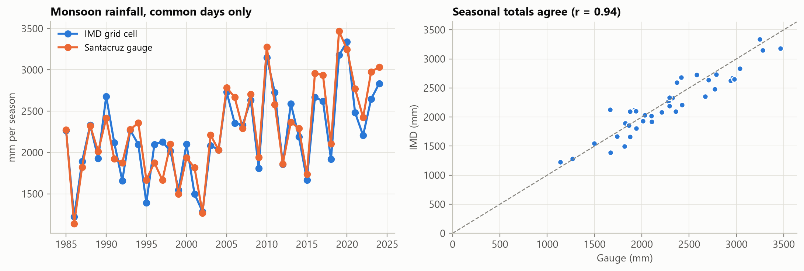
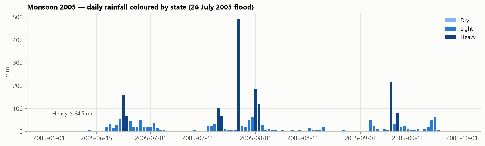
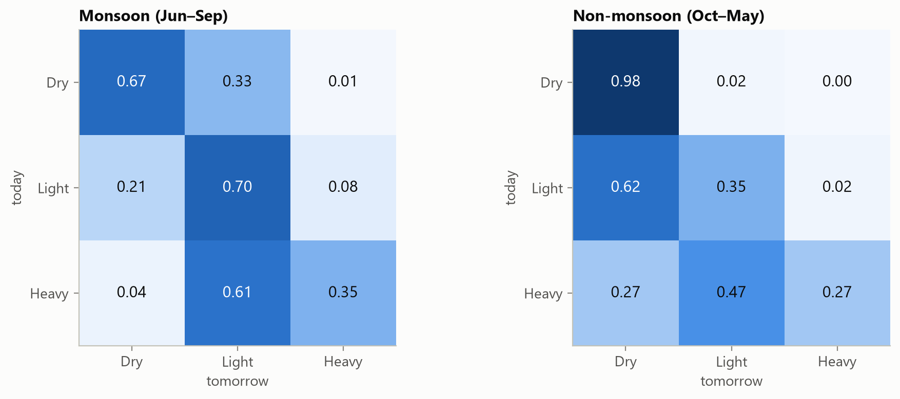
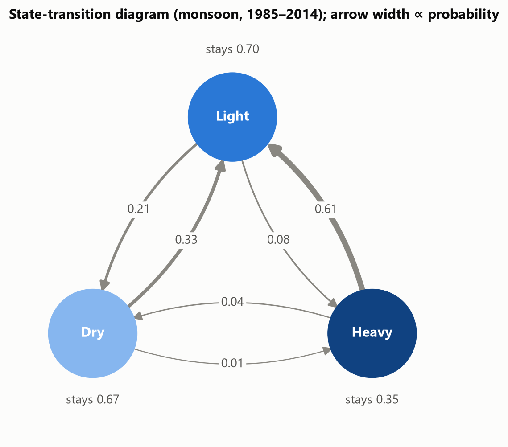
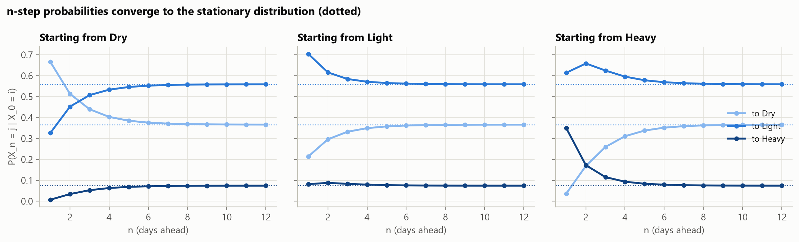
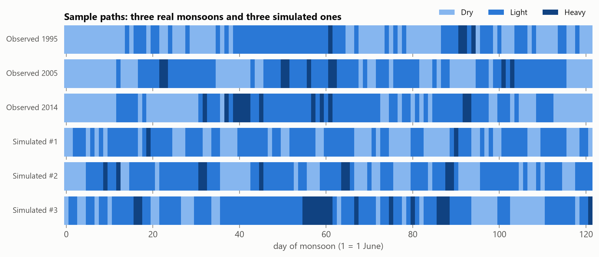
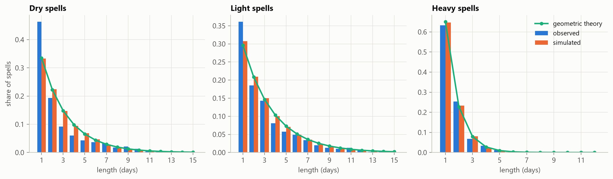
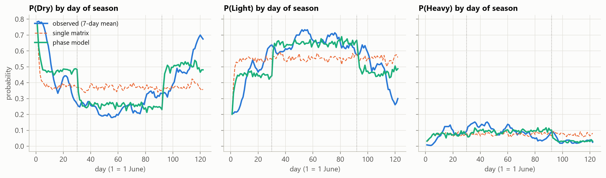
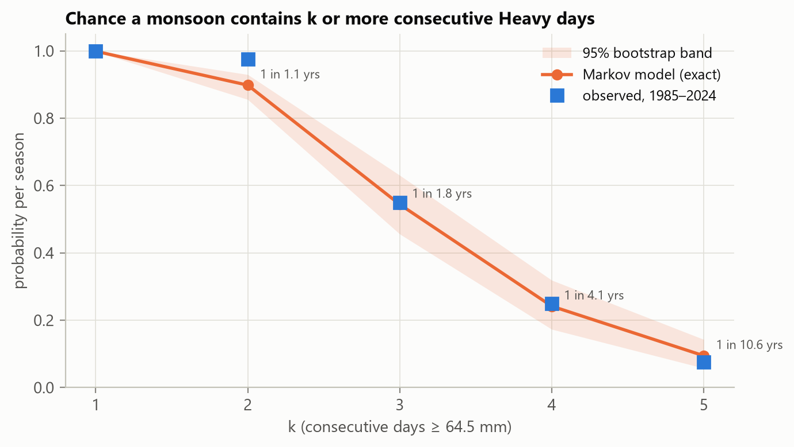
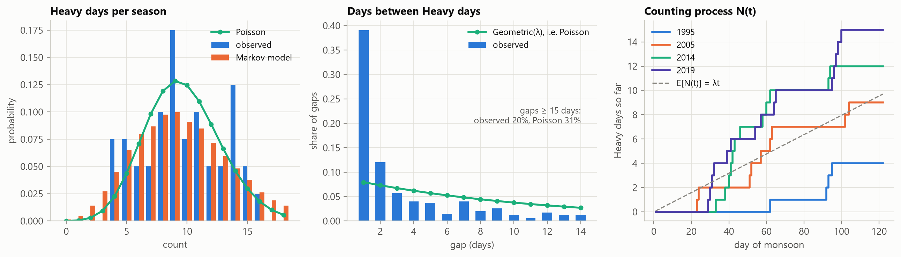

# Abstract

Daily monsoon rainfall in Mumbai is random from one day to the next, but it is not
independent: wet and dry days come in spells. We model the monsoon (1 June – 30 September) as
a three-state discrete-time Markov chain with states Dry (< 2.5 mm), Light (2.5–64.4 mm) and
Heavy (≥ 64.5 mm), following India Meteorological Department (IMD) definitions. We use 40 years
(1985–2024) of IMD 0.25° gridded rainfall, cross-checked against the NOAA GHCN-Daily rain gauge
at Santacruz. Transition probabilities are estimated by maximum likelihood on 1985–2014. We
derive the stationary distribution, n-step behaviour, spell-length distributions, recurrence and
first-passage times, and validate the model with four quantitative tests: Markov order,
simulation of 1,000 synthetic monsoons, out-of-sample forecasting on 2015–2024, and time-homogeneity.
The first-order chain is strongly supported over independence. It reproduces the stationary state
shares, Heavy-spell lengths and the number of Heavy days per season, and beats climatology by
15.5% (Brier skill) on unseen years. It fails for dry-spell lengths, which have monsoon "breaks"
that a memoryless model cannot capture. Fitting separate matrices for onset, peak and withdrawal
improves the fit significantly. As an application, the model gives the exact probability that a
monsoon contains a run of k consecutive Heavy days, a proxy for flood risk: about 54% for three
days (observed 55%) and 9.5% for five days (observed 7.5%). Fitted on 1985–2014 alone, it also
predicts the run frequencies of the unseen 2015–2024 seasons without any rejection. The risk of a
three-day run rose from 0.44 in 1985–2004 to 0.63 in 2005–2024 (Fisher's exact test p = 0.025), a rise
confirmed independently by the rain gauge. Robustness checks against a seasonal forecast baseline,
alternative thresholds and the gauge record leave every conclusion unchanged. Finally, a Poisson process for Heavy days passes a count-dispersion test but
fails decisively on inter-arrival times, showing that Heavy rain clusters in time exactly as the
Markov chain predicts.

# 1. Introduction

Mumbai receives roughly 2,000–2,500 mm of rain a year, almost all of it during the south-west
monsoon. How that rain is distributed in time matters as much as the total. Agriculture and
water supply depend on how long dry spells last, and urban flooding depends on how long heavy
rain persists. Day-to-day rainfall is uncertain, so it is natural to describe it with a
stochastic process.

Markov chains have been used for daily rainfall occurrence since Gabriel and Neumann (1962), who
showed that whether it rains in Tel Aviv today depends on whether it rained yesterday. A Markov
chain is simple enough that every quantity of interest (long-run frequencies, spell lengths,
return periods) can be derived in closed form, yet it captures the persistence that an
independent model misses.

# 2. Problem statement

**Real-world problem.** The timing of monsoon rain in Mumbai: how long dry and wet spells last,
how often heavy rain occurs, and how often it persists for several days.

**Why randomness is involved.** The weather on a given day cannot be predicted with certainty
from the previous day, but it is statistically related to it.

**Questions.**

1. Can a three-state Markov chain describe how Mumbai's monsoon moves between Dry, Light and Heavy days?
2. Does the fitted model reproduce properties it was not fitted to (spell lengths, seasonal counts), and does it forecast unseen years?
3. How often does a monsoon contain k consecutive Heavy days, and has this changed?
4. Do Heavy-rain days arrive as a Poisson process?

# 3. Literature review

- **Gabriel & Neumann (1962)** introduced the two-state first-order Markov chain for daily rainfall occurrence.
- **Anderson & Goodman (1957)** gave the likelihood-ratio and chi-square tests for the order and stationarity of a Markov chain that we use in Section 10.
- **Tong & Gates (1976)** and **Chin (1977)** used AIC to select the order of rainfall chains and found that first order is often adequate but higher orders are sometimes preferred, especially in dry seasons.
- **Katz (1977)** combined a Markov chain for occurrence with a distribution for amounts (the "chain-dependent process"). That is the natural extension of our work.
- **Sonnadara & Jayewardene (2015)** fitted first-order chains to 60 years of daily rainfall at Colombo with monthly stationary probabilities. Their model reproduced mean wet-spell length within ±0.1 day but was weaker for long dry spells, the same pattern we find.
- **Gadgil & Joseph (2003)** describe "breaks" in the Indian monsoon, multi-day dry periods within the rainy season. These explain why dry spells are not geometric.
- **Goswami et al. (2006)** and **Roxy et al. (2017)** report increasing extreme-rainfall events over India in recent decades, the context for our time-homogeneity result.
- **Pai et al. (2014)** describe the IMD 0.25° gridded daily rainfall dataset we use.

# 4. Data description

| | |
|---|---|
| Primary source | IMD 0.25° × 0.25° gridded daily rainfall (Pai et al., 2014), downloaded from IMD Pune with the open-source `imdlib` library |
| Grid cell | Centred 19.00° N, 72.75° E (covers 18.875–19.125° N, 72.625–72.875° E), which contains the Santacruz observatory |
| Period | 1 Jan 1985 – 31 Dec 2024 (14,610 days, no missing values) |
| Monsoon days | 1 June – 30 September each year: 40 × 122 = 4,880 days |
| Cross-check source | NOAA GHCN-Daily station IN012070800 (Bombay/Santacruz), a rain-gauge record |
| Training / test | 1985–2014 (30 seasons) / 2015–2024 (10 seasons) |

**Data quality.** On the 4,440 monsoon days when both sources report, the two agree as follows:

- Daily rainfall correlates at r = 0.80, and seasonal totals at r = 0.94 (Figure 1).
- The two assign the same state on 79.5% of days.
- Only 19 days are Dry in one source and Heavy in the other.

Some disagreement is expected, because a 25 km grid-cell average smooths local showers that a
single gauge records. The gauge is missing 440 monsoon days (9%), so IMD is the primary source.
One instructive case: the 26 July 2005 Mumbai storm appears on 26 July in the gauge record
(461 mm) and on 27 July in the IMD grid (492 mm). The 24-hour rainfall total ends at 08:30 IST, and
the two archives date it differently. Over all 40 years the same-day alignment is clearly best
(r = 0.80 vs 0.40 with a one-day shift), so this does not affect the analysis.

{width=90%}

{width=90%}

# 5. Mathematical background

**Discrete-time Markov chain.** A sequence $X_0, X_1, \dots$ on a finite state space $S$ is a
Markov chain if
$$P(X_{n+1}=j \mid X_n=i, X_{n-1}, \dots, X_0) = P(X_{n+1}=j \mid X_n=i) = p_{ij}.$$
It is time-homogeneous if $p_{ij}$ does not depend on $n$. The matrix $P=(p_{ij})$ is stochastic:
$p_{ij}\ge 0$ and $\sum_j p_{ij}=1$.

**Chapman–Kolmogorov.** $P(X_{m+n}=j\mid X_m=i) = (P^n)_{ij}$.

**Stationary distribution.** If the chain is irreducible and aperiodic (true here: all
$p_{ii}>0$ and every state reaches every other), there is a unique $\pi$ with $\pi P = \pi$ and
$\sum_i\pi_i=1$, and every row of $P^n$ converges to $\pi$. The speed is governed by the
second-largest eigenvalue modulus: $\lVert P^n-\mathbf 1\pi\rVert = O(|\lambda_2|^n)$.

**Spell lengths.** Once in state $i$, the chain stays for another day with probability $p_{ii}$
independently of how long it has already stayed. The spell length $T_i$ therefore satisfies
$$P(T_i=\ell) = (1-p_{ii})\,p_{ii}^{\ell-1},\quad \ell=1,2,\dots \qquad E[T_i]=\frac{1}{1-p_{ii}},$$
a Geometric distribution. This is the memoryless property.

**Recurrence and first passage.** The mean recurrence time of state $i$ is $m_{ii}=1/\pi_i$.
The mean first-passage times $m_{ij}$ to a target $j$ solve
$m_{ij} = 1 + \sum_{k\neq j} p_{ik}\, m_{kj}$, i.e. $(I-Q)\,m = \mathbf 1$, where $Q$ is $P$ with
row and column $j$ removed.

**Poisson process.** Events at rate $\lambda$ with independent increments give
$N(t)\sim\text{Poisson}(\lambda t)$, so $E[N(t)]=\operatorname{Var}[N(t)]=\lambda t$, and the
inter-arrival times are Exponential($\lambda$). In discrete time (days) the analogue is a Bernoulli
process: counts are Binomial ≈ Poisson, and gaps are Geometric($\lambda$).

# 6. The stochastic model

- **Time parameter:** discrete, $n=1,\dots,122$ (days of the monsoon); each year is a separate sequence.
- **State space:** $S=\{D, L, H\}$, defined by the IMD thresholds 2.5 mm and 64.5 mm.
- **Random variables:** $X_n$ = state on day $n$, and $N(t)$ = number of Heavy days by day $t$.
- **Main model:** a time-homogeneous first-order Markov chain with transition matrix $P$ (6 free parameters).
- **Phase model (Upgrade B):** three matrices $P^{(\text{Jun})}, P^{(\text{Jul–Aug})}, P^{(\text{Sep})}$ (18 parameters).

**Assumptions.**

1. Tomorrow depends on today only (first order).
2. The transition probabilities are the same on every monsoon day (main model) or within each phase (phase model).
3. The probabilities are the same in every year.
4. No transition links one September to the next June.

Assumptions 1–3 are tested in Section 10.

# 7. Methodology

## 7.1 Maximum-likelihood estimation

Conditional on the first day of each season, the likelihood of the observed sequences is
$$L(P)=\prod_{i,j} p_{ij}^{\,n_{ij}},$$
where $n_{ij}$ counts $i\to j$ transitions. Maximising $\sum_{ij} n_{ij}\log p_{ij}$ subject to
$\sum_j p_{ij}=1$ with Lagrange multipliers $\mu_i$ gives $n_{ij}/p_{ij}=\mu_i$, hence
$$\hat p_{ij}=\frac{n_{ij}}{n_i},\qquad \operatorname{SE}(\hat p_{ij})=\sqrt{\hat p_{ij}(1-\hat p_{ij})/n_i}.$$

## 7.2 Validation tests

| Test | Statistic | Reference distribution |
|---|---|---|
| Order 0 vs 1, order 1 vs 2 | $G=2(\ell_{\text{high}}-\ell_{\text{low}})$; AIC $=-2\ell+2k$; BIC $=-2\ell+k\log N$ | $\chi^2_4$, $\chi^2_{12}$ |
| Can Light and Heavy merge? (rows L, H equal) | $G=2\sum n_{ij}\log(\hat p_{ij}/\hat p_{\cdot j})$ | $\chi^2_2$ |
| Spell lengths and seasonal counts vs simulation | Pearson $\chi^2$ (tails pooled, expected ≥ 5) | $\chi^2$ |
| Hold-out forecast | Brier score $\frac1N\sum_t\sum_k(f_{tk}-o_{tk})^2$, log-loss, skill vs climatology | — |
| Time-homogeneity, phases | $G=2\sum_g\sum_{ij}n^g_{ij}\log(\hat p^g_{ij}/\hat p_{ij})$ | $\chi^2_{(G-1)k(k-1)}$ |
| Poisson counts | Dispersion $D=(n-1)s^2/\bar N$ | $\chi^2_{n-1}$ |
| Poisson gaps | Pearson $\chi^2$ vs Geometric($\hat\lambda$) | $\chi^2$ |
| Change in flood-run frequency | Fisher's exact test; Spearman trend on year | exact |
| Flood runs out of sample | Exact binomial test, Binomial(10, $p_k$) | exact |

All order models are scored on the same transitions (days 3–122) so that their likelihoods are comparable.
Kolmogorov–Smirnov tests are deliberately not used: spell lengths and counts are whole numbers, and
KS p-values are invalid (too generous) for discrete data. P-values below $10^{-10}$ are reported as
"p < 10⁻¹⁰", because asymptotic $\chi^2$ tails are not meaningful beyond that.

## 7.3 Exact flood-run probability (Upgrade A)

Let $R_k$ be the event that a season contains at least $k$ consecutive Heavy days. We build an
augmented chain on $\{D, L, H_1,\dots,H_{k-1}, A\}$:

- $H_r$ means "Heavy for exactly the last $r$ days".
- $A$ is absorbing and means "a run of $k$ has already occurred".

From $D$ or $L$, a Heavy day leads to $H_1$. From $H_r$, a Heavy day leads to $H_{r+1}$, or to $A$
if $r+1=k$. A non-Heavy day leads to $D$ or $L$ with the original probabilities. Propagating the
1 June distribution through 121 transitions gives $P(R_k)$ exactly, with no simulation needed. The
return period is $T_k=1/P(R_k)$ monsoons. Uncertainty comes from a bootstrap that resamples whole
seasons (300 replicates), and Monte Carlo (20,000 seasons) checks the exact calculation.

# 8. Computational implementation

All code is our own, in Python with numpy and scipy only. No Markov-chain package is used. The full code is linked in the Appendix.

- `markov.py`: estimation, stationary distribution, $P^n$, first passage, an inverse-CDF sampler for whole seasons, run lengths, every test above, and the augmented-chain recursion.
- `analysis.ipynb`: runs the whole pipeline top to bottom and produces every table and figure.

Before touching real data we verified the module on a synthetic chain with known $P$:

- It recovers $P$ to within 0.0006.
- The exact $P(R_3)=0.651$ agrees with simulation (0.645).
- First-passage times agree with simulation (13.64 vs 13.66 days).
- The order test correctly accepts first order (p = 0.47).

# 9. Results on real data

## 9.1 Estimated transition matrix (training 1985–2014)

| from \\ to | Dry | Light | Heavy |
|---|---|---|---|
| **Dry** | 0.666 ± 0.025 | 0.327 ± 0.025 | 0.008 ± 0.005 |
| **Light** | 0.214 ± 0.018 | 0.704 ± 0.020 | 0.082 ± 0.012 |
| **Heavy** | 0.037 ± 0.022 | 0.614 ± 0.058 | 0.349 ± 0.057 |

(± is the 95% confidence half-width.) Dry and Light persist. Heavy usually eases to Light.
The monsoon moves *through* Light: Dry → Heavy (0.008) and Heavy → Dry (0.04) are rare.
Outside the monsoon the chain is almost absorbing in Dry ($p_{DD}=0.98$, Figure 3).

{width=75%}

{width=50%}

## 9.2 Theoretical properties

| | Dry | Light | Heavy |
|---|---|---|---|
| Stationary $\pi$ | 0.366 | 0.559 | 0.075 |
| Observed share | 0.369 | 0.556 | 0.074 |
| Mean spell $1/(1-p_{ii})$ (days) | 2.99 | 3.38 | 1.54 |
| Observed mean spell | 2.90 | 3.34 | 1.54 |
| Mean recurrence $1/\pi_i$ (days) | 2.7 | 1.8 | 13.4 |
| Mean days until next Heavy | 21.5 | 18.9 | 13.4 |

The stationary distribution matches the observed shares to within 0.3 percentage points. With
$|\lambda_2| = 0.51$, the rows of $P^n$ are within 1% of $\pi$ after 7 days (Figure 5): the
monsoon "forgets" its state within a week.

{width=95%}

{width=90%}

# 10. Model validation

**V1. Markov order and number of states.**

| Model | log-lik | params | AIC | BIC |
|---|---|---|---|---|
| Order 0 (independent days) | −3191.6 | 2 | 6387 | 6400 |
| Order 1 (Markov) | −2680.5 | 6 | 5373 | 5410 |
| Order 2 | −2623.4 | 18 | 5283 | 5394 |

Independence is rejected overwhelmingly (G = 1022 on 4 df, p < 10⁻¹⁰). Second order is also
significant (G = 114 on 12 df, p < 10⁻¹⁰), and it remains so using peak-monsoon days alone
(p ≈ 3 × 10⁻⁷), so the two-day memory is real rather than an artefact of mixing phases.
In practice, however:

- First order delivers 90% of the total likelihood gain.
- Second order improves the hold-out Brier score only from 0.457 to 0.445, while tripling the number of parameters.

We keep first order as the main model.

Light and Heavy cannot be merged into one "Wet" state (G = 164 on 2 df, p < 10⁻¹⁰). After a
Heavy day, another Heavy day has probability 0.35, against 0.08 after a Light day. Three states
are justified.

**V2. Simulation of 1,000 synthetic monsoons.** Spell lengths and seasonal counts are emergent
properties the model was not fitted to (Figure 7).

| Spells | Mean observed | Mean simulated | χ² p |
|---|---|---|---|
| Heavy | 1.54 | 1.53 | 0.79 |
| Light | 3.34 | 3.26 | 0.03 |
| Dry | 2.90 | 2.99 | 3 × 10⁻⁸ |

Heavy spells fit very well. Dry spells do not: real data has more one-day dry gaps (46% vs
33%) and also more long dry spells (monsoon breaks; Gadgil & Joseph, 2003). A memoryless spell
cannot be both short and long. Heavy days per season are reproduced on average (9.07 observed vs
9.10 simulated; binned χ² p = 0.67). Real seasons vary somewhat less than simulated ones
(variance 10.6 vs 16.5), but not significantly (p = 0.07).

{width=95%}

**V3. Hold-out forecast, 2015–2024.**

| Forecast | Brier score | Log-loss |
|---|---|---|
| Markov chain (trained 1985–2014) | 0.455 | 0.757 |
| Climatology | 0.539 | 0.897 |

The Brier skill score is 0.155: the chain is 15.5% better than climatology on years it never saw.
Against a tougher baseline that knows the time of season (day-of-season climatology, Brier 0.504)
the skill is 0.097, so the gain comes from day-to-day persistence and not only from seasonality.

**V4. Time-homogeneity.** 1985–2004 and 2005–2024 do *not* share one matrix (G = 19.7 on 6 df,
p = 0.003). In the later period:

- the long-run share of Heavy days rose from 6.9% to 9.1%;
- $p_{HH}$ rose from 0.32 to 0.38;
- Dry → Heavy jumps rose from 0.005 to 0.014.

This is consistent with the reported increase in extreme rainfall over India (Goswami et al., 2006; Roxy et al., 2017).

**Upgrade B: monsoon phases.** A single matrix cannot represent onset and withdrawal (Figure 8).

| | π Dry | π Light | π Heavy | $p_{HH}$ |
|---|---|---|---|---|
| Onset (June) | 0.47 | 0.45 | 0.075 | 0.26 |
| Peak (Jul–Aug) | 0.25 | 0.65 | 0.096 | 0.38 |
| Withdrawal (Sep) | 0.50 | 0.47 | 0.032 | 0.32 |

The phases differ significantly (G = 102 on 12 df, p < 10⁻¹⁰; AIC 5403 → 5325; BIC roughly tied).
The phase model:

- reduces the error in day-by-day state probabilities by a third (0.088 → 0.059);
- fixes Light spell lengths (p 0.02 → 0.15);
- improves the hold-out Brier score slightly (0.455 → 0.451).

Dry spells remain non-geometric, and September dries more gradually than one September matrix allows.

{width=95%}

# 11. Flood risk: runs of consecutive Heavy days

| k consecutive Heavy days | Model (exact) | 95% CI | Monte Carlo | Observed | Return period |
|---|---|---|---|---|---|
| ≥ 2 | 0.898 | 0.86–0.93 | 0.895 | 39/40 | 1.1 yr |
| ≥ 3 | 0.544 | 0.46–0.63 | 0.539 | 22/40 | 1.8 yr |
| ≥ 4 | 0.242 | 0.17–0.32 | 0.240 | 10/40 | 4.1 yr |
| ≥ 5 | 0.095 | 0.06–0.14 | 0.098 | 3/40 | 10.6 yr |

The exact augmented-chain result agrees with Monte Carlo, and the model agrees with the 40-year
record for every k (Figure 9). This comparison is in-sample, since the model was fitted on the
same 40 years. Run lengths are not fitted directly, so the agreement is meaningful, but we also
test it out of sample.

**Out-of-sample check.** The phase model fitted on 1985–2014 *only* predicts how many of the 10
unseen seasons (2015–2024) contain a run of k Heavy days. Under the model this count is
Binomial(10, p_k).

| k | p_k (trained 1985–2014) | Expected of 10 | Observed 2015–2024 | Two-sided binomial p |
|---|---|---|---|---|
| ≥ 2 | 0.880 | 8.8 | 10 | 0.62 |
| ≥ 3 | 0.519 | 5.2 | 8 | 0.11 |
| ≥ 4 | 0.228 | 2.3 | 2 | 1.00 |
| ≥ 5 | 0.089 | 0.9 | 1 | 0.61 |

No prediction is rejected. The model under-predicted 3-day runs (5.2 expected, 8 observed,
P(≥ 8) = 0.07), the same direction as the change found in V4. With only 10 test seasons this is
not significant on its own.

| Period | P(run ≥ 3) | 95% CI | Return period | Observed |
|---|---|---|---|---|
| 1985–2004 | 0.44 | 0.32–0.57 | 2.3 yr | 7/20 |
| 2005–2024 | 0.63 | 0.51–0.72 | 1.6 yr | 15/20 |

A three-day Heavy run went from roughly once every 2.3 monsoons to once every 1.6. Overlapping
confidence intervals are not a test, so we test the change directly: Fisher's exact test on 7/20 vs
15/20 seasons gives p = 0.025, and a trend test over all 40 years gives p = 0.02. With V4
(p = 0.003) and the independent gauge (Section 13), persistent heavy rain has become significantly
more common. For present-day risk, the 2005–2024 figure (0.63) is the relevant one, not the 40-year average.

{width=70%}

# 12. Poisson process for Heavy-rain days

- **Rate.** $\hat\lambda = 0.0795$ Heavy days per day, about 9.7 per season.
- **Counts.** Counts per season have variance/mean = 1.19. The dispersion test does not reject Poisson (D = 46.2 on 39 df, p = 0.20).
- **Timing.** The timing rejects it decisively. 39% of gaps between Heavy days are a single day, against the 8% a Poisson process predicts (χ² p < 10⁻¹⁰; Figure 10).
- **Episodes.** Counting *episodes* (first days of Heavy spells) instead, the variance/mean ratio is 0.64 (p = 0.08), if anything more regular than Poisson.

A counting test alone would have wrongly accepted the Poisson model. The inter-arrival times
show that Heavy days come in bursts, exactly what $p_{HH}=0.35 \gg \pi_H=0.08$ implies, and the
Markov chain represents that clustering naturally.

{width=100%}

# 13. Robustness checks

We asked the questions an independent reviewer would ask and answered each with data.

| Check | Result |
|---|---|
| R1. Tougher forecast baseline (day-of-season climatology) | Markov still better: Brier 0.455 vs 0.504 (skill 0.097) |
| R2. Is the rise in Heavy days an artefact of the IMD grid? | The independent gauge shows it too, more strongly: 7.4% → 11.2% of days, trend p = 0.001 (IMD: 6.8% → 9.1%, p = 0.03) |
| R3. Is Heavy-day clustering just seasonality? | Seasonal rates without clustering give 11% one-day gaps; reality has 39% |
| R4. Is second-order memory caused by mixing two climates? | No: significant within each 20-year half (p = 10⁻⁶ and 0.001) |
| R5. Does the flood-run result depend on the 64.5 mm threshold? | No. P(run ≥ 3), model vs observed: 0.77 vs 0.82 at 50 mm, 0.54 vs 0.55 at 64.5 mm, 0.32 vs 0.33 at 80 mm |
| R6. Does the grid under-count Heavy days? | Slightly: 8.6% vs 9.2% of common days, so our risks are conservative for a single location |
| Variance of Heavy days per season | Model 16.5 vs observed 10.6, not significant (p = 0.07) |

**Multiple testing.** About 20 tests appear in this study. Every conclusion rests either on
p < 0.003 or on a non-rejection, so a Bonferroni-type correction would not change any of them. The one
result near 0.05 (the Fisher test, p = 0.025) is backed by V4 and R2.

**Design fixed in advance.** The states, thresholds, phases and tests were chosen in the project plan
before any result was seen, which guards against tuning the model to the data.

# 14. Discussion

The first-order three-state chain is a good *working* model of Mumbai's monsoon:

- It reproduces the long-run state frequencies almost exactly.
- It captures the persistence that independence misses.
- It forecasts unseen years better than climatology.
- It predicts multi-day Heavy-rain runs, the quantity most relevant to flooding, in close agreement with 40 years of data and on ten unseen years.
- It is not a day-to-day weather forecast: its 15.5% skill comes from persistence alone. Its value is in describing patterns and risk.

Its failures are informative rather than fatal:

- Dry spells have memory beyond one day (monsoon breaks).
- The monsoon has distinct phases.
- The chain has shifted towards more and longer Heavy-rain spells since 2005.

The Poisson analysis shows the value of the Markov view: Heavy rain is not memoryless, and a
model that ignores persistence would underestimate multi-day heavy-rain risk.

# 15. Limitations

1. **Memory beyond one day.** Second order is significant, and dry spells are not geometric.
2. **Not stationary over decades.** One matrix for 40 years averages over a changing climate.
3. **Within-season change** is only approximated by three fixed phases.
4. **Rainfall amounts are discarded.** 65 mm and 492 mm are both "Heavy", so a single extreme day like 26–27 July 2005 is outside the model.
5. **A grid-cell average** records slightly fewer Heavy days than a point gauge (R6), so risks are conservative for a single location.
6. **No physical drivers** are included (El Niño, Indian Ocean Dipole, low-pressure systems).
7. **Calendar phases.** June, July–August and September are fixed blocks, but the monsoon's actual onset date varies from year to year.
8. **Small test samples.** Ten hold-out seasons give little power; the out-of-sample flood test can detect only large errors.

# 16. Conclusion and extensions

A three-state Markov chain, estimated from 40 years of official IMD data, captures the essential
day-to-day structure of Mumbai's monsoon. It passes most quantitative checks, it forecasts unseen
years with 15.5% skill, and it gives an exact, validated answer to a practical question: a
monsoon has about a 54% chance of containing three consecutive heavy-rain days over 1985–2024, and
about 63% in the recent climate (2005–2024). The rise is statistically significant and is confirmed by
an independent rain gauge.

Natural extensions:

- duration-dependent (semi-Markov) or second-order chains for dry spells;
- transition probabilities that vary smoothly with day of season and with year;
- a chain-dependent model for rainfall amounts (Katz, 1977);
- hidden Markov models with weather regimes as hidden states.

# References

1. Anderson, T. W., & Goodman, L. A. (1957). Statistical inference about Markov chains. *Annals of Mathematical Statistics*, 28(1), 89–110.
2. Brier, G. W. (1950). Verification of forecasts expressed in terms of probability. *Monthly Weather Review*, 78(1), 1–3.
3. Chin, E. H. (1977). Modeling daily precipitation occurrence process with Markov chain. *Water Resources Research*, 13(6), 949–956.
4. Gabriel, K. R., & Neumann, J. (1962). A Markov chain model for daily rainfall occurrence at Tel Aviv. *Quarterly Journal of the Royal Meteorological Society*, 88(375), 90–95.
5. Gadgil, S., & Joseph, P. V. (2003). On breaks of the Indian monsoon. *Proceedings of the Indian Academy of Sciences (Earth and Planetary Sciences)*, 112(4), 529–558.
6. Tong, H., & Gates, P. (1976). On Markov chain modeling to some weather data. *Journal of Applied Meteorology*, 15(11), 1145–1151.
7. Goswami, B. N., et al. (2006). Increasing trend of extreme rain events over India in a warming environment. *Science*, 314(5804), 1442–1445.
8. Katz, R. W. (1977). Precipitation as a chain-dependent process. *Journal of Applied Meteorology*, 16(7), 671–676.
9. Nandi, S., Patel, P., & Swain, S. (2024). IMDLIB: An open-source library for retrieval, processing and spatiotemporal exploratory assessments of gridded meteorological observation datasets over India. doi:10.5281/zenodo.7205414.
10. Pai, D. S., et al. (2014). Development of a new high spatial resolution (0.25° × 0.25°) long period (1901–2010) daily gridded rainfall data set over India. *Mausam*, 65(1), 1–18.
11. Roxy, M. K., et al. (2017). A threefold rise in widespread extreme rain events over central India. *Nature Communications*, 8, 708.
12. Sonnadara, D. U. J., & Jayewardene, D. R. (2015). A Markov chain probability model to describe wet and dry patterns of weather at Colombo. *Theoretical and Applied Climatology*, 119, 333–340. doi:10.1007/s00704-014-1117-z.
13. Menne, M. J., et al. (2012). Global Historical Climatology Network – Daily (GHCN-Daily), Version 3. NOAA National Climatic Data Center. doi:10.7289/V5D21VHZ.

# Appendix: Code

All code is our own, written in Python with numpy and scipy only; no Markov-chain or statistics
package does the modelling for us. The complete code is available at:

**https://drive.google.com/PASTE-YOUR-LINK-HERE**

The folder contains:

- `analysis.ipynb`: the Jupyter notebook that runs the whole study from top to bottom (data, estimation, theory, simulation, validation, upgrades, Poisson analysis and robustness checks) and produces every table and figure in this report;
- `markov.py`: the core functions (maximum-likelihood estimation, stationary distribution, first-passage times, the season simulator, all hypothesis tests and the exact flood-run recursion);
- `viz.py`: the shared plot style used by every figure;
- `data/mumbai_daily_rain.csv`: the cleaned daily rainfall series (IMD grid cell and Santacruz gauge, 1985-2024);
- `download_data.py` and `prepare_data.py`: scripts that rebuild the data from the original IMD and NOAA sources.

The random seed is fixed, so every number in this report is reproduced exactly by running the notebook.
